# FaceGroup — Architecture

As of 2026-10-17 · Status: v3.1, after two review rounds and the M1 build ([PLAN_REVIEW.md](PLAN_REVIEW.md)) · Companion to [PLAN.md](../PLAN.md)

FaceGroup is **one local process built as a core with ports and adapters**. Entry points (API, CLI, scheduler) call application services. Services and ports belong to the core and depend only on the domain. Adapters (models, SQLite, decoders) sit outside the core, implement its ports, and are wired in one place. All data lives in one SQLite file in `%LOCALAPPDATA%`, outside OneDrive.

**v1 scope:** faces, image embeddings and OCR. Captions from a vision-language model are **deferred**. Adding them later means one `Captioner` port, one pipeline stage and `ITEM_TEXT.source = 'caption'`; nothing else changes.

There are 11 Mermaid diagrams. They render in VS Code's Markdown preview and on GitHub. Every one was rendered with mermaid-cli 11.4.2 to check the syntax and layout.

---

## 1. Context and file locations

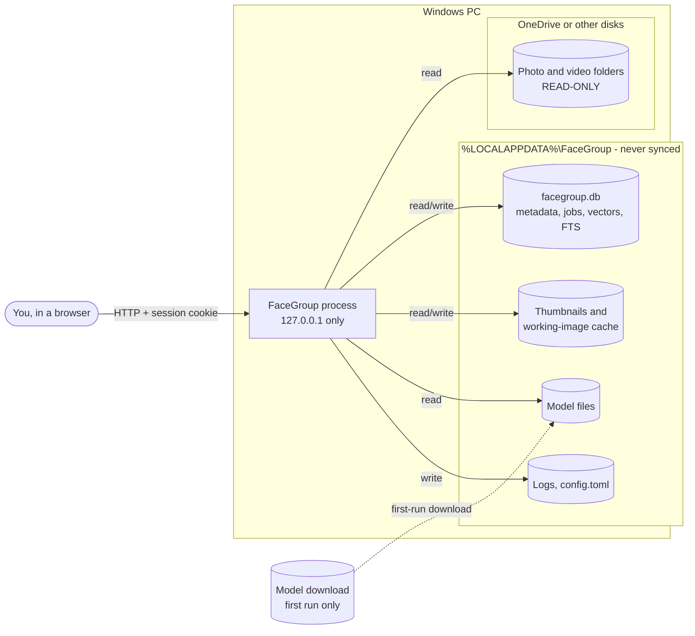

- **The library is never written to.**
- **App data must never be in a synced folder.** OneDrive can corrupt or duplicate a SQLite database and its WAL file. The app refuses to open a database under a OneDrive path.
- **OneDrive "online-only" files are skipped by default** (§3, rule 5).
- After the models are downloaded, the app works fully offline.

---

## 2. Layers: core, ports and adapters

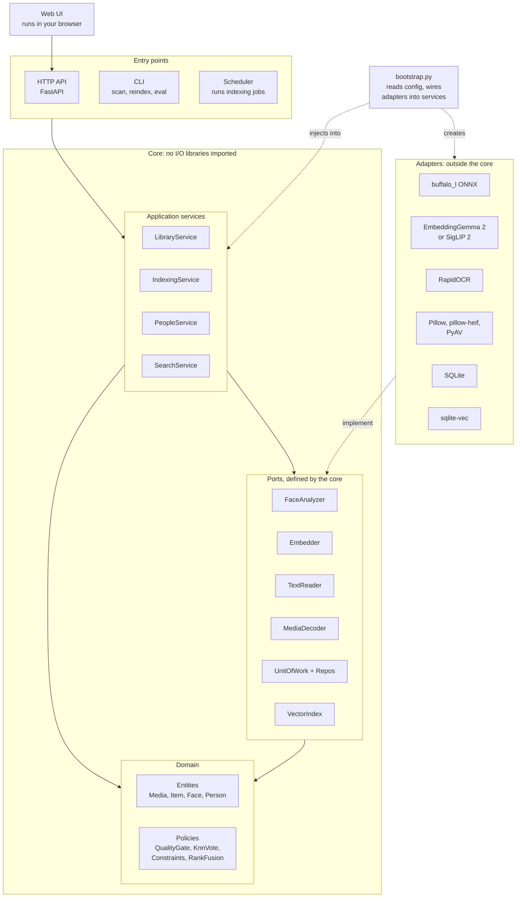

| Rule | Why |
|---|---|
| Every dependency points toward the domain. The domain imports nothing else. Ports are defined in the core, in terms of domain types. | Domain logic (constraints, voting, fusion) is unit-tested with no models or database. |
| Adapters depend on ports, never the reverse. Only `bootstrap.py` knows which adapter is in use. | Swapping buffalo_l for AuraFace, or sqlite-vec for LanceDB, touches one adapter and the config. |
| Entry points only parse input and call one service method. | Merge, split, search and indexing logic each exist in exactly one place. |
| One `Protocol` per model role, chosen in config. No plug-in discovery system. | Simple (KISS) for a single-user app, but models stay swappable. |

| Service | Owns | Never does |
|---|---|---|
| LibraryService | Library folders, discovery, change, move and delete detection | Runs models |
| IndexingService | Stage order, batching, retries, model loading and unloading | Decides who a face belongs to |
| PeopleService | k-NN assignment, suggestions, merge, split, reject, forget | File I/O |
| SearchService | Candidate filtering, vector + keyword retrieval, rank fusion | Writes |

---

## 3. Indexing pipeline

**Item** = one image to analyse. A photo is one item. A video produces one item per sampled frame. Every stage after `derive` works on items, so no stage has a photo/video branch.

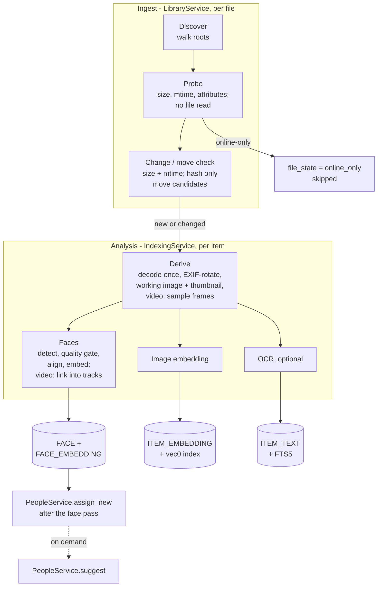

Rules:

1. **Decode once.** `derive` reads the original one time. It applies EXIF orientation, caps the longest side at 2048 px, writes a working image and a thumbnail to the cache, and creates the item rows. It also hashes the bytes it already read (used for move detection). Every later stage reads the working image. Working images are **transient**: deleted once an item has no open jobs (about 15–25 GB for 50k photos otherwise), and rebuilt from the original if a later stage or a new model needs one.
2. **One stage at a time, in batches.** The scheduler loads one indexing model, drains that stage's queue, then unloads it (`max_resident_models = 1`). A decode thread pool feeds a single inference thread. ONNX Runtime chooses its own thread count by default (measured fastest on this hybrid P/E-core CPU; pinning 17 threads was 1.5x slower). Stages that run before items exist (discover, probe, derive) are cheap and need no model.
3. **Idempotent jobs.** Each job has a unique key `(media_id, item_id or null, stage, model_id)`. Writing the result and marking the job `done` happen in one transaction. A new `model_id` creates **new** jobs and leaves the old ones alone.
4. **Crash-safe.** A running job holds a lease with a timeout. Leasing a job counts as an attempt, so a file that crashes the decoder stops after 3 tries instead of looping. Errors are *transient* (retry with backoff) or *permanent* (corrupt file, marked `dead`).
5. **OneDrive online-only files.** `probe` reads the Windows `FILE_ATTRIBUTE_RECALL_ON_DATA_ACCESS` / `OFFLINE` attributes with no file read. Such files get `file_state = online_only` and are skipped unless "fetch online-only files" is on for that root. Move detection hashes only the *new* file, and only when it is local.
6. **Model change = shadow re-index.** New embeddings are built under the new `model_id` while the old ones keep serving search. When the new set is complete, the active model switches in one step and the old vectors are dropped. Labels are unaffected (§4).
7. **Hand-off, not ownership.** IndexingService only stores faces. Who a face belongs to is decided by `PeopleService.assign_new(face_ids)`, which the scheduler calls after each face pass.

### Job lifecycle

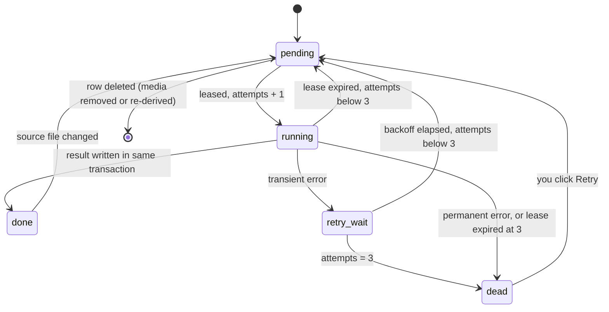

### File (media) lifecycle

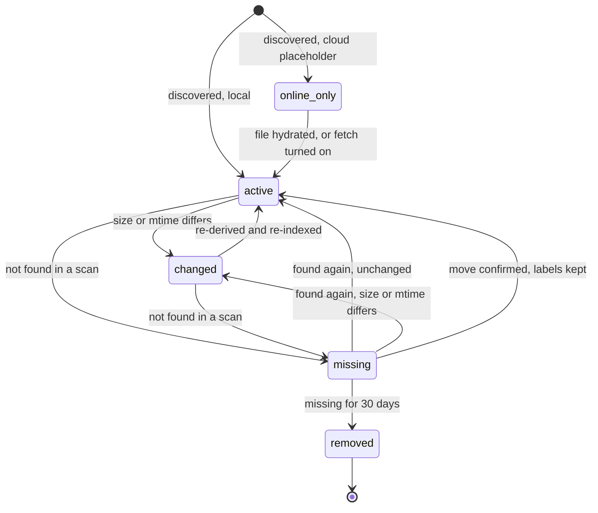

- **Move detection:** when a scan finds a new local path with the same size as a `missing` file, the new file is hashed and compared with the hash stored at derive time (the old file is gone, so it cannot be hashed). If they match, the existing media row is re-pointed to the new path, keeping items, faces, names and vectors.
- **Removal:** after 30 days missing, the media row and its items, faces, embeddings, text and jobs are deleted. People and `PEOPLE_EVENT` history remain. A person left with no faces is hidden.
- Unplugging a drive or a slow OneDrive sync never loses any work.

---

## 4. Data model

Split into two diagrams for readability. `ITEM` appears in both.

### 4a. Library and indexing

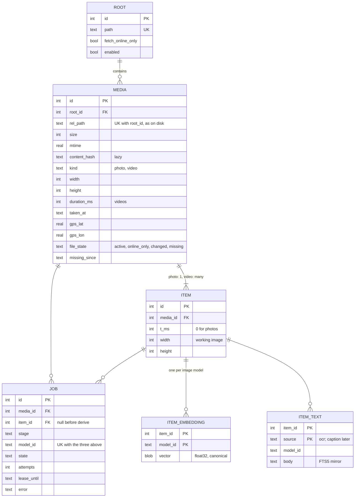

### 4b. People

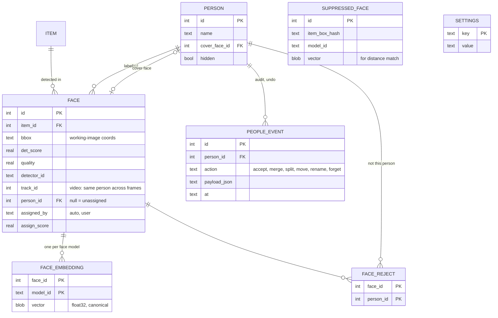

**Key decisions:**

- **Labels live on the detection, not the embedding.** `FACE` is "this box in this image". `FACE_EMBEDDING` holds one vector per face model. A face model change adds embeddings and leaves names, merges and rejections intact. If the *detector* changes, new boxes inherit labels from old boxes overlapping them (IoU > 0.5).
- **One source of truth for vectors.** The `vector` BLOB columns are canonical. sqlite-vec `vec0` tables (one per model and dimension) are a **derived index**, written in the same transaction, and can be rebuilt with `facegroup reindex-vectors`. This matters because sqlite-vec is pre-1.0; its version is pinned.
- **No polymorphic references.** Faces, vectors and text all point at `ITEM`. `JOB` uses `media_id` always and `item_id` once items exist.
- **Merges rewrite `person_id`.** No `merged_into` chains. Every people change is written to `PEOPLE_EVENT`, which gives undo.
- **"Forget this person"** stores each forgotten face's box hash *and* its embedding in `SUPPRESSED_FACE`. Later scans drop a new face that matches either one, which still works after a detector change.
- **`SETTINGS`** holds thresholds and the active model per role.
- **Migrations:** schema version in `PRAGMA user_version`, numbered SQL migration files, run at start-up.

---

## 5. Key flows

### 5a. Scan and index

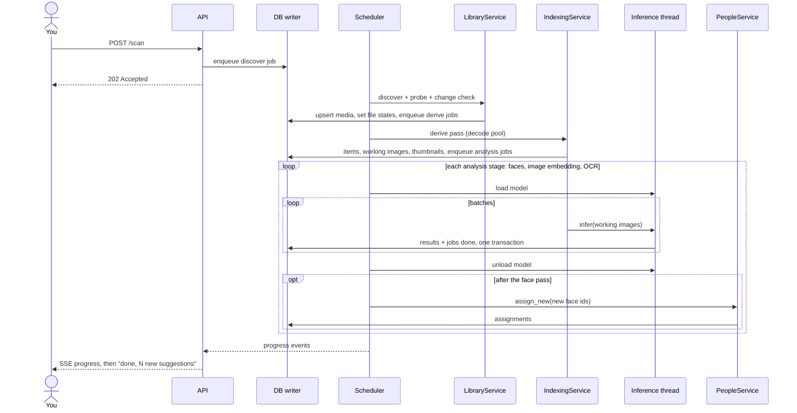

**SQLite concurrency:**

- WAL mode.
- Exactly **one writer connection**, owned by the writer thread. Indexing results *and* your edits (merge, rename, forget) reach it through a command queue.
- Separate read-only connections serve the API and search.
- `busy_timeout` set, and short batched transactions.

### 5b. Face assignment and suggestions

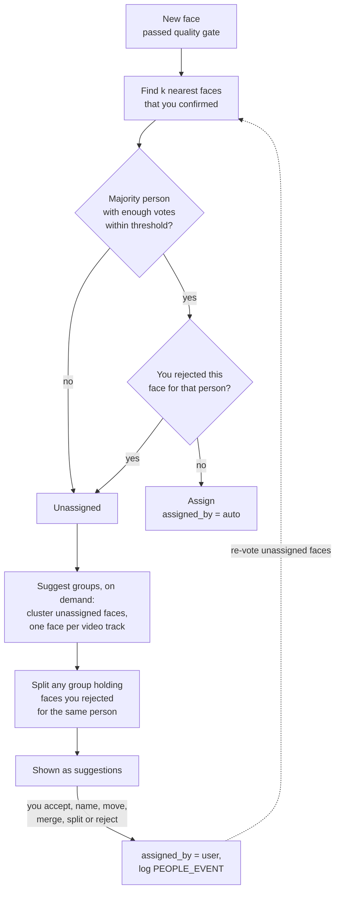

- **First run:** nobody is labelled yet, so nothing is auto-assigned. Everything starts as suggestions. Accepting and naming a few groups is what turns on automatic assignment.
- **Only faces you confirmed vote.** Auto-assigned faces never vote, so mistakes cannot snowball. Every confirmed face votes, so a person naturally has reference faces across ages and lighting, with no separate "centres" to maintain.
- **New labels re-vote the unassigned faces** in the background, so naming a person pulls in their other photos.
- **Your decisions are never overwritten.** Suggestions cover only unassigned faces, so person IDs and names stay stable.
- **Clustering algorithm:** HDBSCAN for up to roughly 50k unassigned faces. Above that, Chinese Whispers on a k-NN graph (or PCA first), because HDBSCAN slows down on 512-dimension vectors.
- **One threshold, adjustable.** Start from the model's recommended value. The People screen has a slider that previews how many faces would be assigned. Per-library automatic tuning waits until the evaluation (PLAN §8) shows it is needed.

### 5c. Search

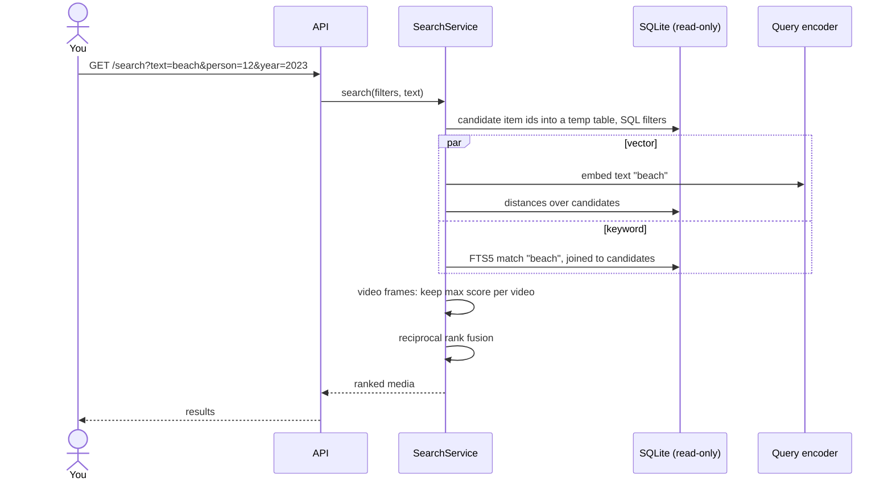

- **Filter first, then rank.** Person, date and folder narrow the set before vector search, so a selective filter can never empty a top-k list. Candidate ids go into a temp table that the vector and FTS5 queries join against, which avoids a huge `IN (...)` list. Under about 200k items, exact distances over the candidates are fast enough.
- **Search by example:** an uploaded photo goes through the *image* side of the embedder for "similar photos". If it contains a face, that face's embedding also finds "photos of this person" by k-NN.
- **Filters are explicit chips** (person, date range, folder). Free-text date parsing is left out of v1.
- The query is embedded with the **same `model_id`** as the active image index. A mismatch is an error, not a silent bad result.
- **Search by place** needs an offline reverse geocoder (GeoNames data) and comes after v1.

---

## 6. Runtime view

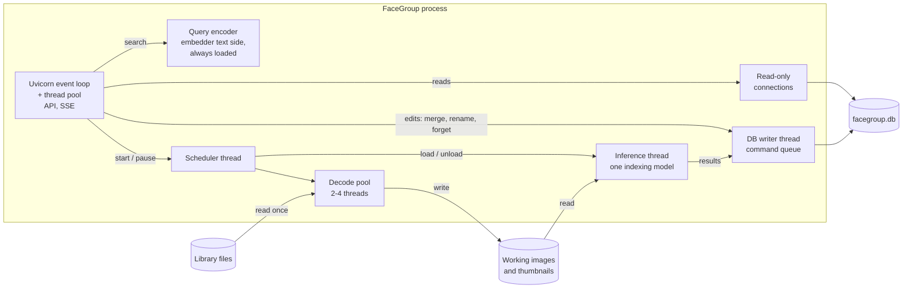

| Component | Approx. RAM | Resident |
|---|---|---|
| Process, API, SQLite page cache | 0.3–0.5 GB | Always |
| Query encoder: EmbeddingGemma 2 text side, fp32 (270M × 4 bytes) | about 1.1 GB | Always (search). Not counted in `max_resident_models` |
| buffalo_l via ONNX Runtime (incl. memory arena) | 1–1.5 GB | Face pass |
| EmbeddingGemma 2 vision side, fp32 (170M × 4 bytes) | about 0.7 GB | Image pass (text side already loaded) |
| SigLIP 2 base, fp32 (alternative, both sides) | about 1.6 GB | Image pass + search |
| RapidOCR | about 0.2 GB | OCR pass |

**Peak RAM is about 3–3.5 GB** during the face pass (0.5 + 1.1 + 1.5), leaving room for a browser on a 16 GB laptop. These figures are estimates from parameter counts; measure them in M1. If memory is tight, the query encoder can be unloaded during indexing, with search paused. Windows `spawn` multiprocessing is avoided because each process would load its own copy of the models.

---

## 7. Code layout

```
facegroup/
  domain/        entities.py, policies.py            # pure, imports nothing from other packages
  ports/         face.py, embed.py, text.py, decode.py, repo.py, vectors.py   # typing.Protocol, domain types only
  services/      library.py, indexing.py, people.py, search.py
  adapters/
    models/      buffalo_onnx.py (+ norm_crop alignment), embeddinggemma2.py, siglip2.py, rapidocr.py
    storage/     sqlite_uow.py, repos.py, writer.py, sqlite_vec_index.py, migrations/0001_init.sql
    media/       decoder.py (Pillow, pillow-heif), video.py (PyAV), onedrive.py, thumbs.py
  entrypoints/   api/ (routers), cli.py, scheduler.py
  web/           templates + static (served by the API, runs in the browser)
  bootstrap.py   config -> adapters -> services
  config.py      typed settings (pydantic-settings, %LOCALAPPDATA%\FaceGroup\config.toml)
tests/
  unit/          domain + services with fake adapters (deterministic vectors)
  property/      "assignment and suggestions never break a user decision"
  integration/   real models on a 50-image fixture set
  eval/          grouping precision/recall per group, search recall@10
```

**buffalo_l without the `insightface` package:** load its ONNX files directly with `onnxruntime` and copy the roughly 20-line `norm_crop` face alignment. This removes the C++ build-tools requirement from the prototype.

---

## 8. Cross-cutting rules

- **Local API security:**
  - Bind to 127.0.0.1 on a fixed port.
  - Allowlist the `Host` header, port included (`127.0.0.1:<port>`, `localhost:<port>`), against DNS rebinding.
  - No CORS.
  - At launch the app opens the browser on a one-time URL carrying a random token. That URL sets an `HttpOnly`, `SameSite=Strict` session cookie and redirects. Every request needs the cookie, which also blocks CSRF on merge, delete and forget.
  - Media is served by `media_id` only, and the server asserts the resolved path is inside a root.
  - Uploads for search-by-example are limited in size and type.
- **Safe decoding:**
  - Keep Pillow's `MAX_IMAGE_PIXELS` and catch `DecompressionBombError`.
  - Apply `exif_transpose` before detection.
  - Read files by bytes, so non-English Windows paths work.
  - HEIC through `pillow-heif`. RAW files are skipped in v1.
  - Video probing has a timeout.
- **Privacy:**
  - No network calls after the model download.
  - "Forget this person" deletes faces, embeddings, crops and thumbnails, writes suppression entries, then runs `VACUUM`.
- **Observability:**
  - Rotating log file.
  - Per-job errors shown in the UI.
  - Progress (items per second, ETA) over SSE.
- **Config:** one validated TOML file. No settings hard-coded in modules.
- **Packaging:**
  - `uv` with a pinned lock file. `uv` installs its own Python 3.11+, so the machine's Python 3.10 does not matter.
  - Pre-built packages only.
  - On Windows, `onnxruntime-directml` (includes the CPU provider); elsewhere `onnxruntime`. Measured on this laptop's integrated GPU: 3x faster than the best CPU setting, identical embeddings. `device = auto | directml | cpu` in config.

---

## 9. M1 implementation notes

Where the M1 code deliberately differs from, or adds to, the design above:

- **No scheduler thread yet.** The CLI runs scan, then the derive pass, then the faces pass, in-process. The scheduler, API and SSE arrive with the UI in M2; services are already shaped for them.
- **Crash recovery uses a single-instance lock** (`facegroup.lock`), so any job still `running` at start-up belongs to a dead process and is re-queued at once instead of waiting for its lease to expire. Re-queuing still counts the attempt, so a file that crashes the process goes `dead` after 3 tries. Leases remain as a second safety net.
- **Re-derived or removed media delete their job rows** rather than marking them `cancelled`.
- **Re-detection keeps face rows:** new boxes that overlap old ones (IoU > 0.5) reuse the old row, so labels survive re-running the face stage. Old faces with a person assigned are never deleted.
- **`rel_path` is stored exactly as on disk**, not NFC-normalised, so the stored path always opens the file.
- **Tables not needed until M2** (`face_reject`, `people_event`, `suppressed_face`) are not created yet; they arrive in migration 0002.

## 10. M2 implementation notes

- **Suggestions = cluster, then clean.** HDBSCAN (leaf selection, PCA to 64 dims above 5,000 faces) proposes groups. Members whose mean similarity to the *rest* of the group is below 0.40 are dropped, then groups whose faces average ≥ 0.55 are merged (average linkage, computed from summed vectors). Tuned on a real library: see docs/EVALUATION.md §3b. This replaces the "split groups holding rejected faces" step in §5b: suggestions only ever contain unassigned faces, and "add to existing person" skips faces rejected for that person.
- **Automatic assignment is recomputed** for every face nobody decided (unassigned or `auto`) after each change, so a correction propagates. The SQL `WHERE assigned_by IS NULL OR assigned_by='auto'` guarantees user decisions are never overwritten, and a Hypothesis property test checks it over random action sequences.
- **An explicit move overrides an earlier rejection** for that face and person (undoable).
- **"Not a person"** is one hidden person of kind `ignored`. Its faces do **not** vote (changed 2026-10-24 after a user report): only faces the user marks go there. Otherwise one wrong mark dragged a real person's look-alikes along. Its page lists them, and "This is a person" sends a face back to unsorted, with a rejection so it is not pulled back.
- **Parts:** review and person pages split faces into parts that look alike (average linkage, cut at 0.45 mean similarity), biggest first. A mixed group can then be broken up part by part: actions apply only to the picked faces, and the rest of the group stays for the next pick.
- **"Forget" clears undo history,** so a forgotten face cannot be brought back with Undo.
- **Scheduler:** one thread that runs scan → derive → faces → people refresh on request. The UI streams its status over SSE (the server polls it twice a second and sends only changes).
- **UI:** server-rendered Jinja templates, htmx 2.0.4 (`hx-boost`) served locally, about 40 lines of plain JS for live status and select-all. Every image is served by id; HEIC/TIFF are converted to JPEG for the browser.

## 11. M3 implementation notes

- **Embedder port** with `embed_images` and `embed_queries`. Each side loads on first use, so the web process only holds the text side (about 0.6 GB at fp16), and the indexing pass only loads the image side while it runs.
- **New item-level stage `embed`** after `faces`. `recover()` queues it for any item that has no job for the current `model_id`, which also covers photos indexed before search existed and future model changes.
- **No sqlite-vec.** Vectors stay canonical in `item_embedding`. For <50k photos an exact dot product over an in-memory matrix (reloaded only when the table changes) takes milliseconds, which is simpler than an approximate index. The `SearchStore` port keeps sqlite-vec or LanceDB possible later.
- **Keyword index:** an FTS5 table over each file's relative path, kept in sync by triggers on `media`. User text is always quoted, so it is never FTS syntax. OCR text joins this index in M4.
- **Search** = SQL filters (person, date, folder) -> vector ranking over the remaining items, plus keyword ranking -> reciprocal rank fusion -> one result per photo. Empty text with filters lists photos newest first.
- **Model choice and parity checks:** docs/EVALUATION.md §6.

## 12. Self-improvement (2026-10-25)

- **Same-photo rule:** two faces in one photo are two different people. Automatic matching keeps only the most confident face per (photo, person), and a photo that already has a confirmed face of someone gets no second automatic one. Suggested groups keep one face per photo, and groups that share a photo never merge.
- **Scorecard** (`assign_feedback`): each time the user confirms, rejects or moves a face that was matched automatically, FaceGroup records whether it was right, with its confidence at the time. Rows are removed with their event on Undo.
- **Learned strictness:** a self-test replays up to 2,500 confirmed faces, spread across people. Each is matched against all the others as if it were unlabelled, and the scorecard rows are added. FaceGroup chooses the loosest threshold whose measured precision meets the target (98% by default), overall and per person, kept within [global - 0.08, global + 0.15] and [0.35, 0.75]. It needs 30 examples to become stricter but 200 to become looser than the default. It re-runs only after 2% more labels or 10 more judged matches (about 1.5 s at 20k confirmed faces). The result is stored in `settings.calibration` and shown on the Check page.
- **Quick check** (`/check`), asking what teaches most per click:
  - Is this group someone you know? A "no" records rejections, so the question is not asked again.
  - Are these two people the same? A "no" is stored in `person_distinct` and never asked again. People seen together in one photo are never asked about.
  - The automatic matches closest to their person's threshold.

## 13. Organising, text and browsing (batches A, B, D, 2026-10-25)

- **Organise pass** (after embed, before OCR): categories by zero-shot SigLIP 2 on stored vectors plus a screenshot rule; duplicates by file hash and 64-bit dHash (computed at derive, backfilled from thumbnails); bursts by folder, time and embedding. Results go in `media_category`, `duplicate_member` and `stack_member`. User choices (category, burst top pick) survive recomputation. Flags (`favorite`, `rating`, `hidden`) are columns on `media`. Nothing is ever written to photo files.
- **OCR stage** runs after organising, because it needs the categories. Only screenshot, document, receipt and meme items are read by default. Text goes to `item_text`, mirrored into FTS5 `ocr_fts` by triggers.
- **Search** fuses three rankings: meaning (vectors), file names and text in images. Names in the query become person filters, with an escape hatch to search the words literally. Results fold bursts.
- **Browsing** reuses search's filter SQL (`_filter_sql`), so the timeline, memories, events and search always agree. Events are gap-based clusters (> 8 h gap, >= 6 photos) computed on request. Saved searches store only whitelisted query parameters.
